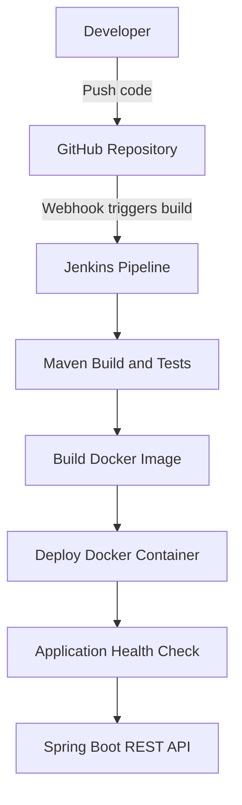

# CloudOpsLab Architecture

## Overview

CloudOpsLab automates the build, testing, containerization, deployment, and health verification of a Spring Boot REST API.

## Architecture Diagram

## Pipeline Stages

1. GitHub stores the source code.
2. Jenkins checks out the latest code.
3. Maven builds the application and runs tests.
4. Docker builds the application image.
5. Jenkins deploys the Docker container.
6. Jenkins verifies application health.

## Application Endpoints

- `/health` - Checks application availability.
- `/students` - Returns sample student data.

Application URL: http://localhost:8082

## Technologies Used

Java 21, Spring Boot, Maven, Git, GitHub, Jenkins, Docker, JUnit, and GitHub Webhooks.
